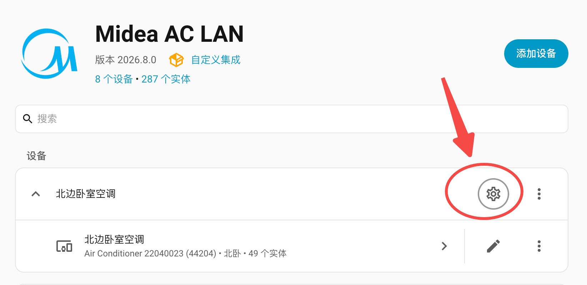
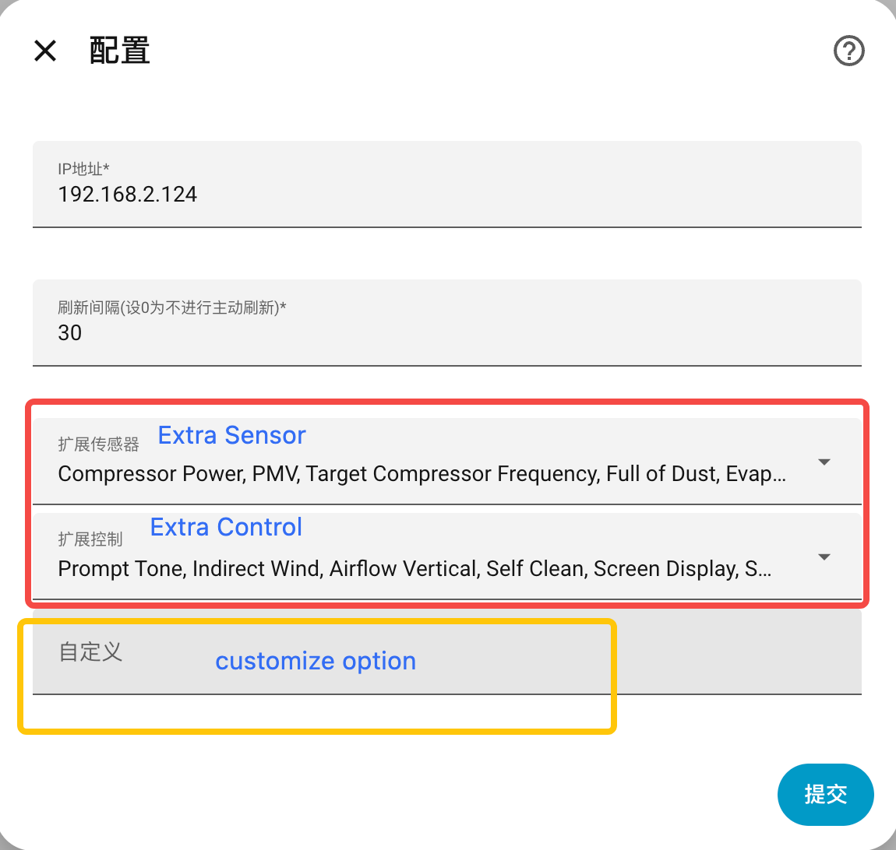

# Midea AC LAN

[](https://github.com/hacs/integration)
[](https://github.com/wuwentao/midea_ac_lan/releases/latest)
[](https://app.codecov.io/gh/wuwentao/midea_ac_lan/tree/main)

English | [简体中文](README_hans.md) | [繁體中文](README_hant.md) | [Discord Chat](https://discord.com/invite/ZWdd2fXndn) | [QQ Group](https://qm.qq.com/q/l53SGEwlZ6)

## Menu

- [1. Important notice](#important-notice)
- [2. Project architecture](#2-project-architecture)
- [3. Supported brands](#3-supported-brands)
- [4. Supported appliances and docs index](#4-supported-appliances-and-docs-index)
- [5. Supported apps and clouds](#5-supported-apps-and-clouds)
- [6. Install midea_ac_lan](#6-install-midea_ac_lan)
  - [6.1 Install via HACS](#61-install-via-hacs)
  - [6.2 Install with Script](#62-install-with-script)
  - [6.3 Manual Install](#63-manual-install)
- [7. Add device](#7-add-device)
  - [7.1 Discover automatically](#71-discover-automatically)
  - [7.2 Configure manually](#72-configure-manually)
  - [7.3 List all appliances only](#73-list-all-appliances-only)
- [8. Configure](#8-configure)
  - [8.1 IP address](#81-ip-address)
  - [8.2 Refresh interval](#82-refresh-interval)
  - [8.3 Extra sensor and switch entities](#83-extra-sensor-and-switch-entities)
  - [8.4 Customize](#84-customize)
- [9. Debug and Test](#9-debug-and-test)
- [10. Contributing Guide](#10-contributing-guide)
  - [10.1 Adding a new device](#101-adding-a-new-device)
- [11. Sponsor this project](#11-sponsor-this-project)

Control your Midea M-Smart appliances over the local network.

- Discover and configure appliances from the Home Assistant UI.
- Create extra sensors and switches for appliance control.
- Keep a long-lived TCP connection to synchronize appliance status in real time.

> `midea_ac_lan` requires only a LAN connection for normal appliance control; it does not use the cloud for routine commands or status updates. However, the appliance's built-in Wi-Fi module is designed to maintain a connection to Midea Cloud after joining a Wi-Fi network. If Internet access is blocked, the module will repeatedly restart and probe for connectivity until it can reach Midea Cloud. This behavior comes from the appliance's Wi-Fi hardware/firmware design; it is not a cloud requirement of this integration.

⭐If this component is helpful for you, please star it, it encourages me a lot.

**_❗Note: This integration requires Home Assistant 2024.4.1 or higher_**

<a id="important-notice"></a>

## 1. ❗❗❗❗❗❗Important Notice❗❗❗❗❗❗

> Note: Cloud login is used to retrieve the appliance Token and Key. Select the same [app/cloud](#5-supported-apps-and-clouds) that owns the appliance. Availability varies by account, region, and device; NetHome Plus cannot retrieve Tokens for now, but the option is retained.
> ❗ SmartHome: Do not migrate your account from another app. You must register a new account and add your appliances; migrated accounts cannot retrieve appliance Tokens.

1. The current 美的美居 and SmartHome Token API services require login with a personal app account, and the appliance must be bound to that account before the Token can be retrieved. Midea may gradually close these Token API services in the future, which may prevent new appliances from being added.
2. For appliances that have been successfully added, please be sure to **copy or back up the appliance's `.json` configuration file to a device outside HAOS** for future use. Old v2 protocol appliances do not have `.json` configuration files, so only v3 protocol appliances need backups.
3. To obtain or restore a device `.json` configuration file, see [Debug and Test](doc/debug.md#4-obtain-device-json-configuration). To restore a backup, copy `<device_id>.json` back to `/config/.storage/midea_ac_lan/` before adding the appliance. The integration automatically loads the saved configuration when the appliance is selected, so you do not need to enter its Token and Key manually.
4. Reason: During the initial design of the Midea v1 LAN API, it was assumed that client communication was already encrypted. Therefore, the tokens generated by the cloud service and used within this encrypted communication were not configured with an expiration time. However, many Home Assistant plugins on GitHub use cracked client encryption methods. Because these tokens cannot expire, this creates a security risk. Midea may therefore gradually shut down the cloud Token API services above and move to the new v2 cloud control API, which would eventually make the v1 LAN control API unavailable.

> If the debug log reports a preset-account login or Token error, you can ignore it. The preset account has no appliances bound to it, and current Midea Cloud services issue device Tokens only through a personal account containing a valid Midea appliance. To troubleshoot a login or Token failure, retry with your own account and check the corresponding debug log.

## 2. Project architecture

Midea AC LAN is split across three repositories, each with a separate responsibility:

| Project                                                    | Responsibility                                                                                                                                   | Installation                                                                                                        |
| ---------------------------------------------------------- | ------------------------------------------------------------------------------------------------------------------------------------------------ | ------------------------------------------------------------------------------------------------------------------- |
| [`midea_ac_lan`](https://github.com/wuwentao/midea_ac_lan) | This Home Assistant integration: configuration flows, entities, services, and the user interface.                                                | Install this integration through HACS or manually.                                                                  |
| [`midea-lan`](https://github.com/wuwentao/midea-lan)       | The Python library used by the integration for device discovery, authentication, encryption, cloud Token/Key retrieval, and appliance protocols. | Installed automatically from the version pinned in [`manifest.json`](custom_components/midea_ac_lan/manifest.json). |
| [`midea-lua`](https://github.com/wuwentao/midea-lua)       | An archive of appliance Lua protocol files used as references when researching or adding device support.                                         | Not a runtime dependency; users do not need to install it.                                                          |

For normal Home Assistant use, install only `midea_ac_lan`. It communicates with appliances through `midea-lan`; `midea-lua` is protocol research material for contributors.

When adding or fixing device support, first find or contribute the relevant Lua protocol in `midea-lua`, implement the protocol behavior in `midea-lan`, and then expose the attributes as Home Assistant entities in `midea_ac_lan`. A change may therefore require linked pull requests across these repositories.

## 3. Supported brands

   \
   \
   \
   \
   \


And more.

## 4. Supported appliances and docs index

> **_❗Note: For each appliance type, configure supported features and parameters according to the documents below. Only enable a feature after confirming that the appliance supports it in the Midea app._**

Please check the document links below for the supported features and usage of each appliance type.

| Type | Name                            | Documents          |
| ---- | ------------------------------- | ------------------ |
| 13   | Light                           | [13.md](doc/13.md) |
| 26   | Bathroom Master                 | [26.md](doc/26.md) |
| 34   | Sink Dishwasher                 | [34.md](doc/34.md) |
| 40   | Integrated Ceiling Fan          | [40.md](doc/40.md) |
| 9B   | Microwave Steam Convection Oven | [9B.md](doc/9B.md) |
| 9C   | Integrated Kitchen Appliance    | [9C.md](doc/9C.md) |
| A1   | Dehumidifier                    | [A1.md](doc/A1.md) |
| AC   | Air Conditioner                 | [AC.md](doc/AC.md) |
| AD   | Air Box                         | [AD.md](doc/AD.md) |
| B0   | Microwave Oven                  | [B0.md](doc/B0.md) |
| B1   | Electric Oven                   | [B1.md](doc/B1.md) |
| B3   | Dish Sterilizer                 | [B3.md](doc/B3.md) |
| B4   | Toaster                         | [B4.md](doc/B4.md) |
| B6   | Range Hood                      | [B6.md](doc/B6.md) |
| B8   | Robot Vacuum                    | [B8.md](doc/B8.md) |
| BF   | Microwave Steam Oven            | [BF.md](doc/BF.md) |
| C1   | Electric Wall-hung Boiler       | [C1.md](doc/C1.md) |
| C2   | Toilet                          | [C2.md](doc/C2.md) |
| C3   | Heat Pump Wi-Fi Controller      | [C3.md](doc/C3.md) |
| CA   | Refrigerator                    | [CA.md](doc/CA.md) |
| CC   | MDV Wi-Fi Controller            | [CC.md](doc/CC.md) |
| CD   | Heat Pump Water Heater          | [CD.md](doc/CD.md) |
| CE   | Fresh Air Appliance             | [CE.md](doc/CE.md) |
| CF   | Heat Pump                       | [CF.md](doc/CF.md) |
| D9   | Washer Dryer Combo              | [D9.md](doc/D9.md) |
| DA   | Top Load Washer                 | [DA.md](doc/DA.md) |
| DB   | Front Load Washer               | [DB.md](doc/DB.md) |
| DC   | Clothes Dryer                   | [DC.md](doc/DC.md) |
| E1   | Dishwasher                      | [E1.md](doc/E1.md) |
| E2   | Electric Water Heater           | [E2.md](doc/E2.md) |
| E3   | Gas Water Heater                | [E3.md](doc/E3.md) |
| E6   | Gas Boiler                      | [E6.md](doc/E6.md) |
| E8   | Electric Slow Cooker            | [E8.md](doc/E8.md) |
| EA   | Electric Rice Cooker            | [EA.md](doc/EA.md) |
| EC   | Electric Pressure Cooker        | [EC.md](doc/EC.md) |
| ED   | Water Drinking Appliance        | [ED.md](doc/ED.md) |
| FA   | Fan                             | [FA.md](doc/FA.md) |
| FB   | Electric Heater                 | [FB.md](doc/FB.md) |
| FC   | Air Purifier                    | [FC.md](doc/FC.md) |
| FD   | Humidifier                      | [FD.md](doc/FD.md) |

## 5. Supported apps and clouds

The setup list comes from [`SUPPORTED_CLOUDS`](https://github.com/wuwentao/midea-lan/blob/main/midealan/cloud.py) in `midea-lan`:

| Option shown in setup | Cloud implementation | Notes                                                                                                         |
| --------------------- | -------------------- | ------------------------------------------------------------------------------------------------------------- |
| 美的美居              | `MeijuCloud`         | Use a personal account with the appliance bound to it.                                                        |
| SmartHome             | `SmartHomeCloud`     | Use a newly registered personal account; accounts migrated from another app cannot retrieve appliance Tokens. |
| Midea Air             | `MideaAirCloud`      | Uses the legacy Midea Air cloud backend.                                                                      |
| NetHome Plus          | `MideaAirCloud`      | Uses the legacy backend. Token retrieval is currently unavailable, but the option is retained.                |
| Ariston Clima         | `MideaAirCloud`      | Uses the legacy backend.                                                                                      |
| TSmartLife            | `TSmartLifeCloud`    | Toshiba's overseas/non-Japan app; it uses a cloud deployment separate from Toshiba Iolife.                    |
| Toshiba Iolife        | `ToshibaIOLife`      | Toshiba Iolife app and cloud, separate from TSmartLife.                                                       |

Choose the option for the app where the appliance is registered. An account from one app normally cannot access appliances registered in another cloud. A listed backend means the integration implements its login flow; successful Token/Key retrieval still depends on the cloud service, account region, and appliance.

## 6. Install midea_ac_lan

### 6.1 Install via HACS

> [!IMPORTANT]
>
> 1. Home Assistant <= 2026.10: Make sure you have installed `HACS` in Home Assistant using the [HACS install guide](https://hacs.xyz/docs/use/download/download/).
> 2. Home Assistant >= 2026.11: `HACS` ships with Home Assistant as the `Marketplace` integration. Go to [`Settings > Devices & services > Marketplace`](https://my.home-assistant.io/redirect/integration?domain=marketplace).

[](https://my.home-assistant.io/redirect/hacs_repository/?owner=wuwentao&repository=midea_ac_lan)

**Restart Home Assistant**.

### 6.2 Install with Script

> run this script in HA Terminal or SSH add-on

```shell
wget -O - https://github.com/wuwentao/midea_ac_lan/raw/main/scripts/install.sh | ARCHIVE_TAG=latest bash -
```

### 6.3 Manual Install

1. Download `midea_ac_lan.zip` from [Latest Release](https://github.com/wuwentao/midea_ac_lan/releases/latest)
2. Extract `midea_ac_lan.zip`.
3. Copy the extracted files into `/config/custom_components/midea_ac_lan` in Home Assistant, so `manifest.json` is directly under `/config/custom_components/midea_ac_lan/`.
4. **Restart Home Assistant**.

After restarting, open `[Settings]`, `[Device & services]`, `[Integrations]`, `[Midea AC Lan]` to finish the initial setup and add your appliances.

## 7. Add device

**_❗Note: First, set a static IP address for your appliance in the router, in case the IP address of the appliance changes after set-up._**

After installation, search for and add the `Midea AC LAN` integration from the Home Assistant integrations page. To add multiple appliances, add this integration multiple times and run automatic configuration each time.

Or click [](https://my.home-assistant.io/redirect/config_flow_start?domain=midea_ac_lan)

**_❗Note: During configuration, you may be asked to sign in to a [supported app/cloud](#5-supported-apps-and-clouds) because the appliance Token and Key must be retrieved from its cloud service. After all appliances are configured, back up each v3 appliance `.json` configuration file for future use. See [Obtain Device JSON Configuration](doc/debug.md#4-obtain-device-json-configuration)._**

> To restore a backup, copy `<device_id>.json` to `/config/.storage/midea_ac_lan/` before adding the appliance. The integration loads it automatically when the appliance is selected; manual Token/Key entry is not required.

After the Midea account login is complete, click 'ADD DEVICE' to add an appliance. You can repeat this process to add multiple appliances.

### 7.1 Discover automatically

Using this option, the integration can discover and list Midea M-Smart appliances on the network or at a specified IP address. Select one from the list to add it.

You can also use an IP address to search within a specified network, such as `192.168.1.255`.

**_❗Note: Automatic discovery requires your appliances and Home Assistant to be in the same subnet. Otherwise, appliances cannot be discovered. You can enter an IP address directly instead._**

### 7.2 Configure manually

If you have manually configured the appliance through another integration before, or already have a Token/Key backup, you can add the appliance manually.

- Appliance code
- Appliance type (one of [Supported appliances and docs index](#4-supported-appliances-and-docs-index))
- IP address
- Port (default 6444)
- Protocol version
- Token
- Key

> Do not modify appliance configurations unless you know what you are changing. Adding an incorrect appliance configuration may cause abnormal appliance status or make control unavailable.

### 7.3 List all appliances only

Using this option, you can list all discoverable Midea M-Smart devices on the network, along with their IDs, types, SNs, and other information.

**_❗Note: Not all supported devices may be listed here. If a device cannot be scanned, it may not be supported at the moment._**

## 8. Configure

Configuration can be found in `Settings -> Devices & Services -> Midea AC LAN -> Devices -> CONFIGURE`.
You can reset the IP address when the appliance IP changes.
You can also add extra sensor and switch entities, or customize your appliance.

> ❗❗❗ After an appliance is added successfully, not all features are enabled by default. You still need to adjust the configuration, mainly by manually enabling or disabling features according to what the appliance supports.



### 8.1 IP address

Set the IP address of the appliance. You can reset this when the appliance IP changes.

### 8.2 Refresh interval

Set the interval for actively refreshing the status of a single appliance, in seconds. The default is 30, and 0 disables active refresh.
Most Midea appliances actively notify status changes, \
so HA status updates still work normally even if the refresh interval is set to "0". \
This component will also actively query the device status at regular intervals, and the default time is 30 seconds. \
Some appliances do not send active notifications when their status changes, so status synchronization in HA will be slower. \
If you are very concerned about the synchronization speed of the status, you can try to set a shorter status refresh interval.

**_❗Note: a shorter refresh interval may mean more resource consumption_**

### 8.3 Extra sensor and switch entities

After configuration, one or a few main entities (such as a climate entity) may be generated by default. If you want to expose other attributes as extra sensor or switch entities, click CONFIGURE in the Midea AC LAN integration card and select the sensors and switches to generate. Your appliance MUST support the selected features.
Refer to the documents for each appliance type before enabling them.

### 8.4 Customize

Some appliance types have their own customization items. You can use them to customize appliance features. If your appliance does not work properly, or if displayed values are abnormal, you may need customization to fix it. Refer to the appliance documentation for specific configuration information.

The format of `Customize` must be `JSON`.

If multiple customization items need to be configured, the settings must comply with the JSON format.

Example

```json
{ "refresh_interval": 15, "fan_speed": 100 }
```

> Whether `Customize` is supported depends on the appliance type. Refer to the corresponding appliance documentation.



## 9. Debug and Test

For getting debug logs or modifying source code, please refer to [Debug and Test](doc/debug.md).

## 10. Contributing Guide

Development uses [uv](https://docs.astral.sh/uv/) (no Docker required). Install uv, then:

```shell
git clone https://github.com/wuwentao/midea_ac_lan.git
cd midea_ac_lan
./scripts/setup.sh
```

See [CONTRIBUTING](.github/CONTRIBUTING.md) for full setup, running Home Assistant locally, and the code style / commit rules. The [testing guide](doc/testing.md) describes the Home Assistant pytest harness, coverage reports, and supported-version matrix.

### 10.1 Adding a new device

Want to expose a new Midea appliance type in this integration? The end-to-end recipe — pointing the `midea-lan` dependency at your library work for local testing, registering the device in `midea_devices.py`, choosing each attribute's platform / `device_class` / `unit` / `translation_key`, adding the translation files, writing the device docs, and opening a PR — is documented, using the `0xD9` washer/dryer combo ([PR #1086](https://github.com/wuwentao/midea_ac_lan/pull/1086)) as the running example and the `0x9B` oven ([PR #1096](https://github.com/wuwentao/midea_ac_lan/pull/1096)) as a second, larger example:

- [Adding a New Device to the midea_ac_lan Integration](doc/adding-a-new-device.md)
- [为 midea_ac_lan 集成新增一款设备（中文）](doc/adding-a-new-device.zh-Hans.md)

The companion guide for the protocol library side lives in the `midea-lan` repo: [Adding a New Device Type](https://github.com/wuwentao/midea-lan/blob/main/docs/adding-a-new-device.md).

Device Lua protocol files are collected in [`midea-lua`](https://github.com/wuwentao/midea-lua). If the protocol for your appliance is missing, use the `midea-lan` download command described in the [`midea-lua` README](https://github.com/wuwentao/midea-lua#download-files), contribute the file there, and link it from your `midea-lan` pull request.

## 11. Sponsor this project

If this project helps you, consider sponsoring its ongoing development, maintenance, and community support.

<p>
  <a href="https://buymeacoffee.com/wuwentao"></a>
  <a href="https://www.paypal.me/wuwentao2000"></a>
</p>
