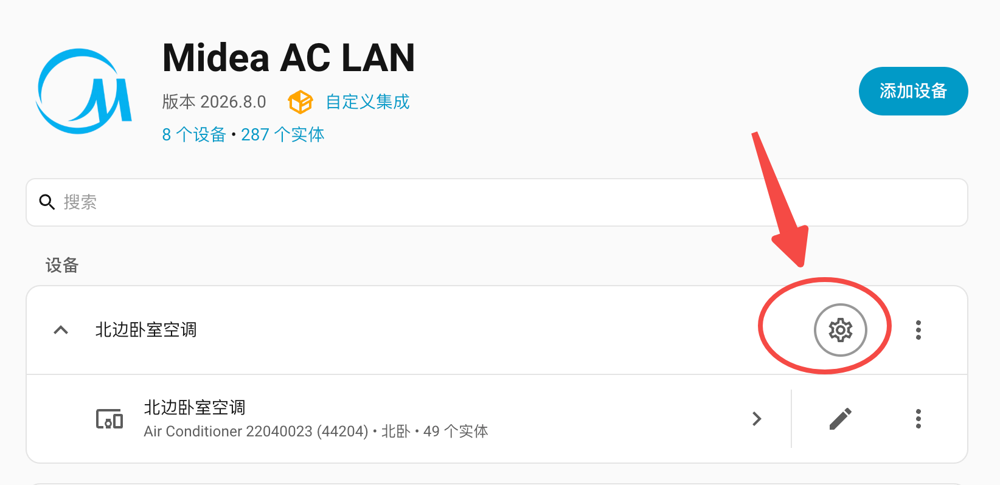
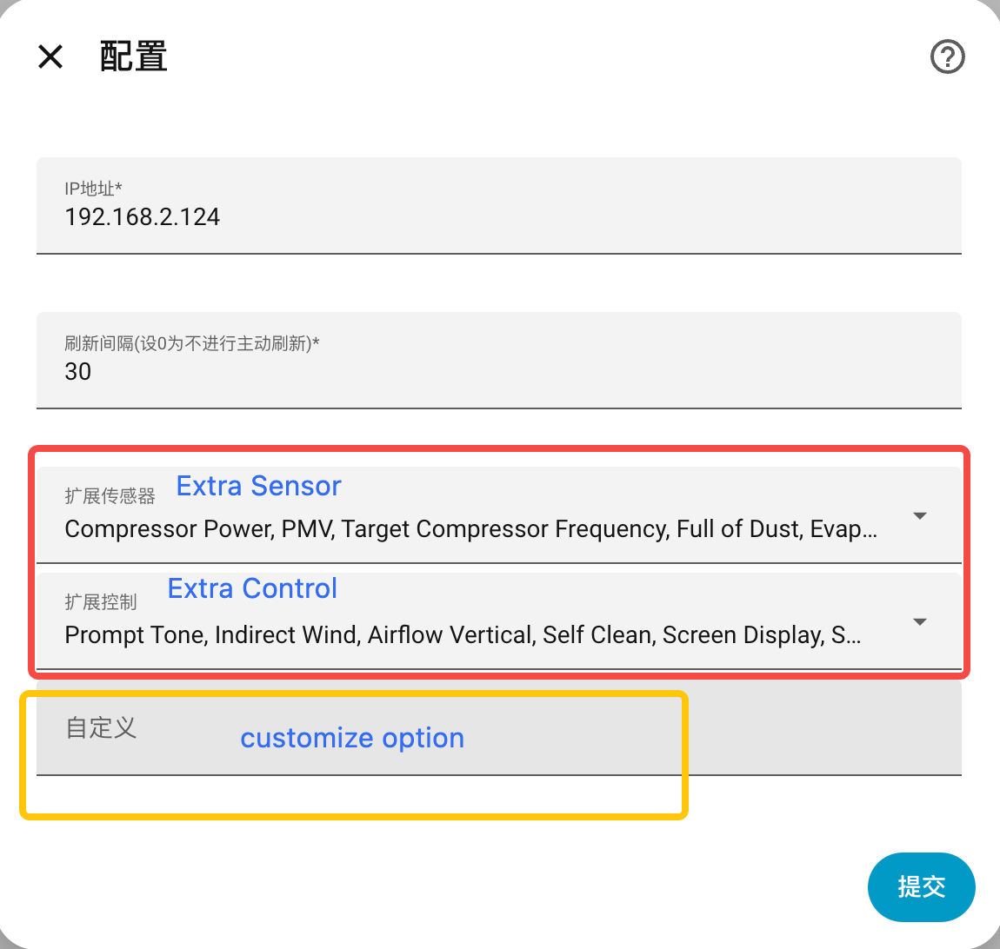

# Midea AC LAN

[](https://github.com/hacs/integration)
[](https://github.com/wuwentao/midea_ac_lan/releases/latest)
[](https://app.codecov.io/gh/wuwentao/midea_ac_lan/tree/main)

[English](README.md) | 简体中文 | [繁體中文](README_hant.md) | [Discord交流群](https://discord.com/invite/ZWdd2fXndn) | [QQ交流群](https://qm.qq.com/q/l53SGEwlZ6)

## 导航

- [1. 重要提醒](#important-notice)
- [2. 项目架构](#2-项目架构)
- [3. 已支持的品牌](#3-已支持的品牌)
- [4. 已支持的设备和文档索引](#4-已支持的设备和文档索引)
- [5. 支持的 App 与云端](#5-支持的-app-与云端)
- [6. 安装 midea_ac_lan](#6-安装-midea_ac_lan)
  - [6.1 通过 HACS 安装](#61-通过-hacs-安装)
  - [6.2 使用脚本安装](#62-使用脚本安装)
  - [6.3 手工安装](#63-手工安装)
- [7. 添加设备](#7-添加设备)
  - [7.1 自动搜索](#71-discover-automatically--自动搜索)
  - [7.2 手动配置](#72-configure-manually--手动配置)
  - [7.3 仅列出所有设备](#73-list-all-appliances-only--仅列出所有设备)
- [8. 配置](#8-配置)
  - [8.1 IP 地址](#81-ip地址)
  - [8.2 刷新间隔](#82-刷新间隔)
  - [8.3 额外的传感器及开关实体](#83-额外的传感器及开关实体)
  - [8.4 自定义](#84-自定义)
- [9. Debug 调试和测试](#9-debug调试和测试)
- [10. Contributing Guide](#10-contributing-guide)
  - [10.1 新增设备支持](#101-新增设备支持)
- [11. 赞助本项目](#11-赞助本项目)

通过本地局域网控制你的美的M-Smart设备

- 通过Home Assistant UI完成设备的自动搜索和配置.
- 生成额外的传感器和开关方便进行设备控制.
- 与设备保持TCP长连接以便实时同步设备状态.

> `midea_ac_lan` 日常控制设备时只需要局域网连接，不通过云端发送控制命令或同步状态。但是，美的设备内置的 Wi-Fi 模块在接入 Wi-Fi 网络后仍必须能够连接 Midea Cloud。若禁止设备访问互联网，该模块会持续重启并反复检测网络，直至能够连接 Midea Cloud。这是设备 Wi-Fi 硬件/固件自身的设计，并不表示本集成的日常控制依赖云端。

⭐如果本集成对你有所帮助, 请不吝为它点个星, 这将是对我的极大激励。

**_❗注意: 本集成需要 Home Assistant 2024.4.1 或更高版本_**

<a id="important-notice"></a>

## 1. ❗❗❗❗❗❗重要提醒❗❗❗❗❗❗

> 注意：云端登录仅用于获取设备 Token 和 Key。请选择设备所属的同一个 [App/云端](#5-支持的-app-与云端)。可用性取决于账号、地区和设备；NetHome Plus 暂时无法获取 Token，但仍保留该选项。
> ❗ SmartHome： 请勿从其他APP迁移账号，需要全新注册并添加设备，迁移账号无法获取设备Token。

1. 目前美的美居、SmartHome Token API服务，需要使用个人App账号登录并且设备绑定在该账户下，才能获取Token, 后续美的可能会陆续关闭Token API服务，可能导致无法添加新设备。
2. 已经添加成功的设备，请**务必将设备的.json配置文件复制或备份至HAOS之外的其他设备**，供后续使用（通讯协议为v2的旧设备无配置文件，无需备份，仅通讯协议为v3的设备需要备份）
3. 获取或恢复设备 `.json` 配置文件，请参考 [Debug 调试和测试](doc/debug_hans.md#4-获取设备-json-配置文件)。恢复备份时，请在添加设备前将 `<device_id>.json` 复制回 `/config/.storage/midea_ac_lan/`。选择设备后，本集成会自动加载已保存的配置，无需手工输入 Token 和 Key。
4. 关闭原因： 美的设计v1局域网API时，认为客户端通讯已经加密，因此在加密通讯里面使用云端服务生成的token并未设置过期时间。但目前Github存在大量使用破解了客户端加密模式的HA插件，由于Token无法过期，存在安全隐患，因此美的会陆续关闭以上所有云端token API服务，逐步切换至新的v2云端控制API, 从而导致v1局域网控制API无法使用。

> 如果 debug 日志中出现预设账号登录或 Token 获取错误，可以忽略。预设账号没有绑定任何设备，而当前 Midea Cloud 仅允许通过已绑定有效美的设备的个人账号获取设备 Token。排查登录或 Token 获取问题时，请使用你自己的账号重试，并检查对应的 debug 日志。

## 2. 项目架构

Midea AC LAN 由三个职责不同的仓库共同组成：

| 项目                                                       | 职责                                                                                           | 安装方式                                                                                                     |
| ---------------------------------------------------------- | ---------------------------------------------------------------------------------------------- | ------------------------------------------------------------------------------------------------------------ |
| [`midea_ac_lan`](https://github.com/wuwentao/midea_ac_lan) | 当前 Home Assistant 集成，负责配置流程、实体、服务和用户界面。                                 | 通过 HACS 或手工安装本集成。                                                                                 |
| [`midea-lan`](https://github.com/wuwentao/midea-lan)       | 本集成使用的 Python 库，负责设备发现、身份验证、加密、从云端获取 Token/Key，以及各类设备协议。 | Home Assistant 会根据 [`manifest.json`](custom_components/midea_ac_lan/manifest.json) 中锁定的版本自动安装。 |
| [`midea-lua`](https://github.com/wuwentao/midea-lua)       | 设备 Lua 协议文件存档，供研究或新增设备支持时参考。                                            | 不是运行时依赖，普通用户无需安装。                                                                           |

正常使用 Home Assistant 时，只需安装 `midea_ac_lan`。本集成通过 `midea-lan` 与设备通信；`midea-lua` 是供贡献者研究协议的参考资料。

新增或修复设备支持时，请先在 `midea-lua` 中查找或贡献对应的 Lua 协议，再在 `midea-lan` 中实现协议行为，最后在 `midea_ac_lan` 中将属性暴露为 Home Assistant 实体。因此，一项改动可能需要在这三个仓库中提交相互关联的 PR。

## 3. 已支持的品牌

   \
   \
   \
   \
  

以及更多。

## 4. 已支持的设备和文档索引

> **_❗注意: 每种设备支持的功能和参数列表需参考以下文档进行配置，并确认美的APP中该设备支持该功能后再启用_**

请通过以下文档链接查看每种设备支持的功能及使用方法

| 类型 | 名称                        | 文档                         |
| ---- | --------------------------- | ---------------------------- |
| 13   | 灯                          | [13_hans.md](doc/13_hans.md) |
| 26   | 浴霸                        | [26_hans.md](doc/26_hans.md) |
| 34   | 水槽式洗碗机                | [34_hans.md](doc/34_hans.md) |
| 40   | 凉霸                        | [40_hans.md](doc/40_hans.md) |
| 9B   | 微波蒸汽热风一体机          | [9B_hans.md](doc/9B_hans.md) |
| 9C   | 集成灶                      | [9C_hans.md](doc/9C_hans.md) |
| A1   | 除湿器                      | [A1_hans.md](doc/A1_hans.md) |
| AC   | 空调器                      | [AC_hans.md](doc/AC_hans.md) |
| AD   | 空气盒子                    | [AD_hans.md](doc/AD_hans.md) |
| B0   | 微波炉                      | [B0_hans.md](doc/B0_hans.md) |
| B1   | 电烤箱                      | [B1_hans.md](doc/B1_hans.md) |
| B3   | 消毒碗柜                    | [B3_hans.md](doc/B3_hans.md) |
| B4   | 小烤箱                      | [B4_hans.md](doc/B4_hans.md) |
| B6   | 油烟机                      | [B6_hans.md](doc/B6_hans.md) |
| B8   | 扫地机器人                  | [B8_hans.md](doc/B8_hans.md) |
| BF   | 微蒸烤一体机                | [BF_hans.md](doc/BF_hans.md) |
| C1   | 电壁挂炉                    | [C1_hans.md](doc/C1_hans.md) |
| C2   | 智能马桶                    | [C2_hans.md](doc/C2_hans.md) |
| C3   | 热泵空调Wi-Fi线控器         | [C3_hans.md](doc/C3_hans.md) |
| CA   | 冰箱                        | [CA_hans.md](doc/CA_hans.md) |
| CC   | 中央空调(风管机)Wi-Fi线控器 | [CC_hans.md](doc/CC_hans.md) |
| CD   | 空气能热水器                | [CD_hans.md](doc/CD_hans.md) |
| CE   | 新风设备                    | [CE_hans.md](doc/CE_hans.md) |
| CF   | 中央空调暖家(水机)          | [CF_hans.md](doc/CF_hans.md) |
| D9   | 洗烘一体机                  | [D9_hans.md](doc/D9_hans.md) |
| DA   | 波轮洗衣机                  | [DA_hans.md](doc/DA_hans.md) |
| DB   | 滚筒洗衣机                  | [DB_hans.md](doc/DB_hans.md) |
| DC   | 干衣机                      | [DC_hans.md](doc/DC_hans.md) |
| E1   | 洗碗机                      | [E1_hans.md](doc/E1_hans.md) |
| E2   | 电热水器                    | [E2_hans.md](doc/E2_hans.md) |
| E3   | 燃气热水器                  | [E3_hans.md](doc/E3_hans.md) |
| E6   | 壁挂炉                      | [E6_hans.md](doc/E6_hans.md) |
| E8   | 慢炖锅                      | [E8_hans.md](doc/E8_hans.md) |
| EA   | 电饭煲                      | [EA_hans.md](doc/EA_hans.md) |
| EC   | 电压力锅                    | [EC_hans.md](doc/EC_hans.md) |
| ED   | 饮用水设备                  | [ED_hans.md](doc/ED_hans.md) |
| FA   | 电风扇                      | [FA_hans.md](doc/FA_hans.md) |
| FB   | 电取暖器                    | [FB_hans.md](doc/FB_hans.md) |
| FC   | 空气净化器                  | [FC_hans.md](doc/FC_hans.md) |
| FD   | 加湿器                      | [FD_hans.md](doc/FD_hans.md) |

## 5. 支持的 App 与云端

配置界面中的选项来自 `midea-lan` 的 [`SUPPORTED_CLOUDS`](https://github.com/wuwentao/midea-lan/blob/main/midealan/cloud.py)：

| 配置界面选项   | 云端实现          | 说明                                                              |
| -------------- | ----------------- | ----------------------------------------------------------------- |
| 美的美居       | `MeijuCloud`      | 使用个人账号，并确保设备已绑定到该账号。                          |
| SmartHome      | `SmartHomeCloud`  | 使用全新注册的个人账号；从其他 App 迁移的账号无法获取设备 Token。 |
| Midea Air      | `MideaAirCloud`   | 使用旧版 Midea Air 云端后端。                                     |
| NetHome Plus   | `MideaAirCloud`   | 使用旧版后端；目前无法获取 Token，但仍保留该选项。                |
| Ariston Clima  | `MideaAirCloud`   | 使用旧版后端。                                                    |
| TSmartLife     | `TSmartLifeCloud` | 东芝海外（非日本国内）App；其云端与 Toshiba Iolife 相互独立。     |
| Toshiba Iolife | `ToshibaIOLife`   | Toshiba Iolife App 和云端，与 TSmartLife 相互独立。               |

请选择设备实际注册所在的 App。一个 App 的账号通常无法访问注册在其他云端的设备。列表中存在某个后端，表示本集成已实现其登录流程；能否成功获取 Token/Key，仍取决于云服务、账号地区和具体设备。

## 6. 安装 midea_ac_lan

请使用以下方式安装:

### 6.1 通过 HACS 安装

> [!IMPORTANT]
>
> 1. Home Assistant <= 2026.10：请先按照 [HACS 安装指南](https://hacs.xyz/docs/use/download/download/)在 Home Assistant 中安装 `HACS`。
> 2. Home Assistant >= 2026.11：`HACS` 以 `Marketplace` 集成的形式内置于 Home Assistant。请前往[`设置 > 设备与服务 > Marketplace`](https://my.home-assistant.io/redirect/integration?domain=marketplace)。

[](https://my.home-assistant.io/redirect/hacs_repository/?owner=wuwentao&repository=midea_ac_lan)

**重启 Home Assistant**。

### 6.2 使用脚本安装

> 在HomeAssistant的Terminal add-on或者SSH中执行以下脚本

```shell
wget -O - https://github.com/wuwentao/midea_ac_lan/raw/main/scripts/install.sh | ARCHIVE_TAG=latest bash -
```

### 6.3 手工安装

> 1. 从[Latest Release](https://github.com/wuwentao/midea_ac_lan/releases/latest) 下载 `midea_ac_lan.zip`
> 2. 解压 `midea_ac_lan.zip`.
> 3. 将解压后的文件复制到 Home Assistant 的 `/config/custom_components/midea_ac_lan` 中，确保 `manifest.json` 直接位于 `/config/custom_components/midea_ac_lan/` 下。
> 4. **重启 Home Assistant**.

重启完成后, 打开 `[Settings]`, `[Device & services]`, `[Integrations]`, `[Midea AC Lan]`, 进行初始化设置并添加所有设备.

## 7. 添加设备

**_❗注意: 首先, 在路由器上为你的设备设置一个静态IP地址, 以防设置后设备的IP地址发生改变。_**

安装之后, 在Home Assistant的集成界面搜索添加集成Midea AC LAN, 如果需要添加多台设备, 多次添加本集成并执行自动配置即可。

或者直接点击 [](https://my.home-assistant.io/redirect/config_flow_start?domain=midea_ac_lan)

**_❗注意：配置过程中，可能需要登录一个[受支持的 App/云端](#5-支持的-app-与云端)，以便从对应云服务获取设备的 Token 和 Key。完成所有设备配置后，请备份每个 v3 设备的 `.json` 配置文件供后续使用。请参考[获取设备 JSON 配置文件](doc/debug_hans.md#4-获取设备-json-配置文件)。_**

> 恢复备份时，请在添加设备前将 `<device_id>.json` 复制到 `/config/.storage/midea_ac_lan/`。选择设备后，本集成会自动加载该文件，无需手工输入 Token/Key。

完成美的账户登录之后, 点击'添加设备'进行设备添加。你可以多次重复操作以添加多台设备。

### 7.1 Discover automatically / 自动搜索

使用此选项, 组件会列出网络上或者指定IP地址上的设备, 选择一个并进行添加。

你也可以使用IP地址在指定网络中搜索, 比如`192.168.1.255`

**_❗注意: 自动配置要求设备必须与HA在同一网段, 否则搜索不到设备，可以直接输入IP地址_**

### 7.2 Configure manually / 手动配置

如果之前你已经通过其它集成手工配置过设备或者已有设备Token/Key备份, 也可以进行手动配置

- 设备ID
- 设备类型（[已支持的设备和文档索引](#4-已支持的设备和文档索引)之一）
- IP地址
- 端口(默认为6444)
- 协议版本
- Token
- Key

> 请勿随意修改设备的配置，添加错误的设备配置将导致设备状态异常或无法控制

### 7.3 List all appliances only / 仅列出所有设备

使用此选择, 可以列出网络中所有可以被搜索到的美的M-Smart设备, 以及他们的ID, 类型, SN等信息

**_❗注意: 可能不是所有受支持的设备都能于此列出， 如果无法扫描到设备，目前可能暂不支持_**

## 8. 配置

集成配置位于 `设置 -> 设备与服务 -> Midea AC LAN -> 设备` 在指定的设备下，点击 `配置`。
在配置中, 你可以在设备IP改变后重新指定IP地址, 也可以增加扩展的传感器或开关等实体或者自定义你的设备

> ❗❗❗ 设备添加成功以后，默认并不会自动启用所有功能，仍然需要进行一些自定义的配置，主要根据设备支持的功能来手工开启或关闭不支持的功能



### 8.1 IP地址

指定设备的IP地址。当你的设备IP地址变动后, 可以重新设定它

### 8.2 刷新间隔

指定单台设备的主动状态刷新间隔 (单位为秒) (默认值为30, 设0代表不进行主动刷新)

大部分的美的设备在自身状态改变时会主动发送通知, 在这种情况下, 即使将改值设为0, 也不会影响HA中的设备状态更新。组件默认每间隔30秒会进行主动刷新。部分设备没有状态改变时主动通知的机制, 状态同步就会表现得很慢, 这种情况下可以尝试更短的主动状态更新间隔。

**_❗注意: 更小的更新间隔意味着更多的资源消耗_**

### 8.3 额外的传感器及开关实体

配置完成后, 可能会默认生成一个或几个主要实体(比如climate实体)。如果需要其它属性生成为扩展的传感器及开关实体, 在Midea AC LAN集成卡片上点击`配置`, 并选择要生成的传感器及开关(设备必须支持该功能)。
需要参考各个不同型号的设备文档来添加。

### 8.4 自定义

某些类型的设备有它们自己的自定义项, 可以通过自定义项定制设备的功能。如果你的设备无法正常工作,或结果显示异常,也许你需要自定义来修复它。请参阅设备文档以获取具体的配置信息。

自定义`Customize`的格式必须是`JSON`。

如果要设置多个自定义项, 请注意遵循JSON的格式要求

示例

```json
{ "refresh_interval": 15, "fan_speed": 100 }
```

> 是否支持`Customize`选择根据设备类型，参考对应的设备文档



## 9. Debug调试和测试

获取Debug Log或者修改源码，请参考[Debug调试和测试](doc/debug_hans.md)

## 10. Contributing Guide

开发环境使用 [uv](https://docs.astral.sh/uv/)（无需 Docker）。安装 uv 后：

```shell
git clone https://github.com/wuwentao/midea_ac_lan.git
cd midea_ac_lan
./scripts/setup.sh
```

完整的环境搭建、本地运行 Home Assistant、代码风格与提交规范，请参考 [中文版CONTRIBUTING](.github/CONTRIBUTING.zh.md)。Home Assistant pytest 测试框架、覆盖率报告和版本兼容矩阵请参考[测试指南](doc/testing.zh-Hans.md)。

### 10.1 新增设备支持

想在本集成中暴露一款新的美的设备类型？从把 `midea-lan` 依赖指向你的库改动以便本地测试、在 `midea_devices.py` 中注册设备、为每个属性选择 platform / `device_class` / `unit` / `translation_key`、添加翻译文件、编写设备文档，到提交 PR 的完整流程都有文档说明，并以 `0xD9` 洗烘一体机（[PR #1086](https://github.com/wuwentao/midea_ac_lan/pull/1086)）作为贯穿示例，另以 `0x9B` 烤箱（[PR #1096](https://github.com/wuwentao/midea_ac_lan/pull/1096)）作为第二个、更大的范例：

- [为 midea_ac_lan 集成新增一款设备（中文）](doc/adding-a-new-device.zh-Hans.md)
- [Adding a New Device to the midea_ac_lan Integration（English）](doc/adding-a-new-device.md)

协议库侧的配套指南位于 `midea-lan` 仓库：[新增设备类型支持指南](https://github.com/wuwentao/midea-lan/blob/main/docs/adding-a-new-device.zh-Hans.md)。

设备 Lua 协议文件统一收集在 [`midea-lua`](https://github.com/wuwentao/midea-lua)。如果缺少你的设备协议，请按照 [`midea-lua` README](https://github.com/wuwentao/midea-lua#download-files) 中的说明，使用 `midea-lan` 的下载命令获取并贡献协议文件，然后在 `midea-lan` PR 中链接该文件。

## 11. 赞助本项目

如果这个项目对你有帮助，欢迎赞助项目的持续开发、日常维护和社区支持。

<p>
  <a href="https://buymeacoffee.com/wuwentao"></a>
  <a href="https://www.paypal.me/wuwentao2000"></a>
</p>
