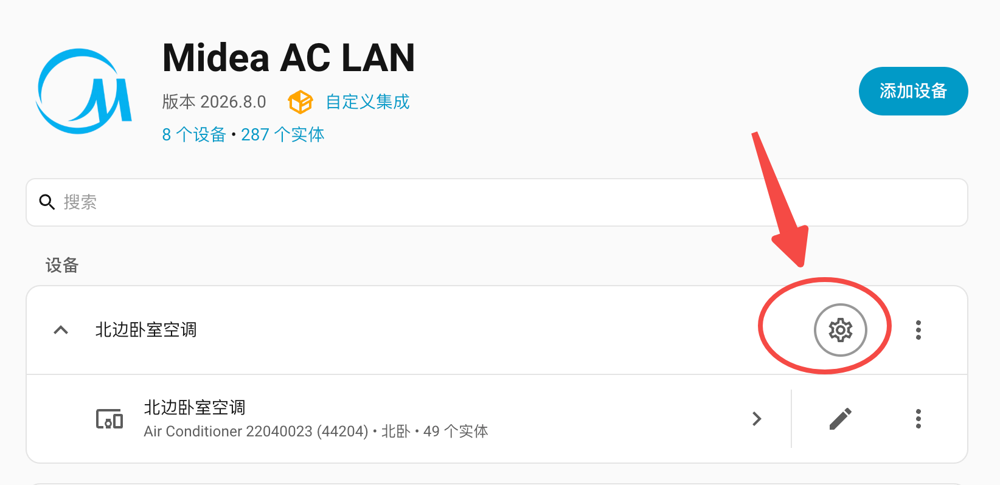
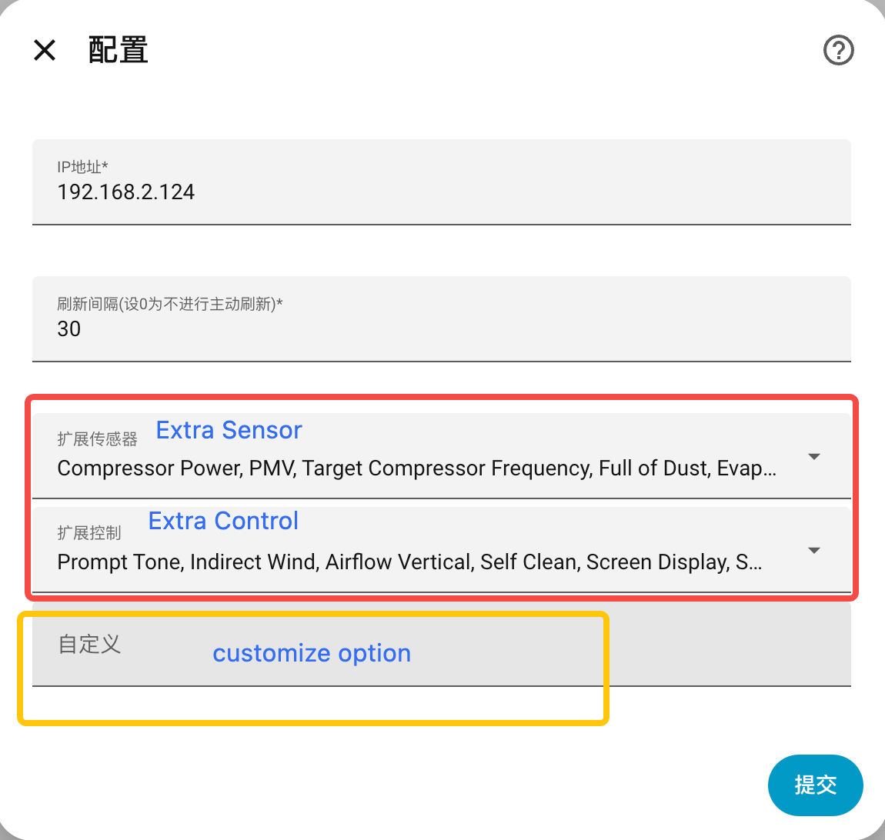

# Midea AC LAN

[](https://github.com/hacs/integration)
[](https://github.com/wuwentao/midea_ac_lan/releases/latest)
[](https://app.codecov.io/gh/wuwentao/midea_ac_lan/tree/main)

[English](README.md) | [简体中文](README_hans.md) | 繁體中文 | [Discord 交流群](https://discord.com/invite/ZWdd2fXndn) | [QQ 群](https://qm.qq.com/q/l53SGEwlZ6)

透過區域網路控制你的美的 M-Smart 家電。

- 在 Home Assistant 介面中探索並設定家電。
- 建立額外的感測器與開關，方便控制家電。
- 維持長時間的 TCP 連線，即時同步家電狀態。

> `midea_ac_lan` 在一般家電控制時只需要區域網路連線；日常指令與狀態更新都不會使用雲端。不過，家電內建的 Wi-Fi 模組在連上 Wi-Fi 後，設計上會持續與美的雲端保持連線。若網際網路被封鎖，模組會不斷重新啟動並探測連線，直到能連上美的雲端為止。這是家電 Wi-Fi 硬體／韌體本身的設計，並非本整合對雲端的需求。

⭐如果這個元件對你有幫助，請幫忙按個星星，這對我是很大的鼓勵。

**_❗注意：本整合需要 Home Assistant 2024.4.1 或更新版本_**

## 1. ❗❗❗❗❗❗重要通知❗❗❗❗❗❗

> 注意：雲端登入用於取得家電的 Token 與 Key。請選擇擁有該家電的同一個 [App／雲端](#61-支援的-app-與雲端)。可用性會依帳號、地區與裝置而異；NetHome Plus 目前無法取得 Token，但仍保留此選項。
> ❗ SmartHome：請勿從其他 App 遷移帳號。你必須註冊新帳號並重新加入家電；遷移過來的帳號無法取得家電 Token。

1. 目前的 美的美居 與 SmartHome Token API 服務，需要以個人 App 帳號登入，且家電必須已綁定在該帳號下，才能取得 Token。美的日後可能會逐步關閉這些 Token API 服務，屆時可能無法再加入新家電。
2. 對於已成功加入的家電，請務必**將家電的 `.json` 設定檔複製或備份到 HAOS 以外的裝置**，以備日後使用。舊的 v2 協定家電沒有 `.json` 設定檔，因此只有 v3 協定的家電需要備份。
3. 若要取得或還原裝置的 `.json` 設定檔，請參閱[偵錯與測試](doc/debug.md#4-obtain-device-json-configuration)。要還原備份時，請在加入家電之前，把 `<device_id>.json` 複製回 `/config/.storage/midea_ac_lan/`。選擇該家電時，整合會自動載入已儲存的設定，因此不需要手動輸入 Token 與 Key。
4. 原因：美的 v1 區域網路 API 在最初設計時，假設用戶端的通訊本來就已加密，因此雲端服務所產生、並在這段加密通訊中使用的 Token，並未設定到期時間。然而，GitHub 上許多 Home Assistant 外掛使用的是被破解的用戶端加密方式。由於這些 Token 無法過期，因此形成安全風險。美的可能因此逐步關閉上述雲端 Token API 服務，並轉往新的 v2 雲端控制 API，最終讓 v1 區域網路控制 API 無法使用。

> 如果偵錯記錄中出現預設帳號登入或 Token 錯誤，可以忽略。預設帳號沒有綁定任何家電，而目前的美的雲端服務只會透過含有有效美的家電的個人帳號核發裝置 Token。若要排查登入或 Token 取得失敗的問題，請改用你自己的帳號重試，並查看對應的偵錯記錄。

## 2. 專案架構

Midea AC LAN 分成三個儲存庫，各自負責不同的工作：

| 專案 | 職責 | 安裝方式 |
| ---------------------------------------------------------- | ------------------------------------------------------------------------------------------------------------------------------------------------ | ------------------------------------------------------------------------------------------------------------------- |
| [`midea_ac_lan`](https://github.com/wuwentao/midea_ac_lan) | 本 Home Assistant 整合：設定流程、實體、服務與使用者介面。 | 透過 HACS 或手動安裝本整合。 |
| [`midea-lan`](https://github.com/wuwentao/midea-lan) | 整合所使用的 Python 函式庫，負責裝置探索、驗證、加密、雲端 Token／Key 取得與家電協定。 | 依 [`manifest.json`](custom_components/midea_ac_lan/manifest.json) 鎖定的版本自動安裝。 |
| [`midea-lua`](https://github.com/wuwentao/midea-lua) | 家電 Lua 協定檔案的存檔，在研究或新增裝置支援時作為參考。 | 不是執行時期相依套件；使用者不需要安裝。 |

一般使用 Home Assistant 時，只需要安裝 `midea_ac_lan`。它會透過 `midea-lan` 與家電通訊；`midea-lua` 是提供貢獻者使用的協定研究資料。

新增或修正裝置支援時，請先在 `midea-lua` 中找到或貢獻對應的 Lua 協定，接著在 `midea-lan` 實作協定行為，最後在 `midea_ac_lan` 將屬性對外提供為 Home Assistant 實體。因此，一項變更可能需要在這些儲存庫之間提交相互連結的 Pull Request。

## 3. 支援的品牌

   \
   \
   \
   \
   \


以及更多。

## 4. 支援的家電

> **_❗注意：每一種家電類型，請依照下列文件設定支援的功能與參數。請先在美的 App 中確認家電支援該功能，再啟用它。_**

請參閱下方的文件連結，了解各類型家電支援的功能與使用方式。

| 類型 | 名稱 | 文件 |
| ---- | ---- | ---- |
| 13 | 燈具 | [13.md](doc/13.md) |
| 26 | 浴室暖風機 | [26.md](doc/26.md) |
| 34 | 水槽洗碗機 | [34.md](doc/34.md) |
| 40 | 吊扇燈 | [40.md](doc/40.md) |
| 9B | 微波蒸氣烘烤爐 | [9B.md](doc/9B.md) |
| 9C | 廚房整合家電 | [9C.md](doc/9C.md) |
| A1 | 除濕機 | [A1.md](doc/A1.md) |
| AC | 冷氣機 | [AC.md](doc/AC.md) |
| AD | 空氣盒子 | [AD.md](doc/AD.md) |
| B0 | 微波爐 | [B0.md](doc/B0.md) |
| B1 | 電烤箱 | [B1.md](doc/B1.md) |
| B3 | 餐具消毒櫃 | [B3.md](doc/B3.md) |
| B4 | 烤麵包機 | [B4.md](doc/B4.md) |
| B6 | 排油煙機 | [B6.md](doc/B6.md) |
| B8 | 掃地機器人 | [B8.md](doc/B8.md) |
| BF | 微波蒸氣爐 | [BF.md](doc/BF.md) |
| C1 | 電熱壁掛爐 | [C1.md](doc/C1.md) |
| C2 | 馬桶 | [C2.md](doc/C2.md) |
| C3 | 熱泵 Wi-Fi 控制器 | [C3.md](doc/C3.md) |
| CA | 冰箱 | [CA.md](doc/CA.md) |
| CC | MDV Wi-Fi 控制器 | [CC.md](doc/CC.md) |
| CD | 熱泵熱水器 | [CD.md](doc/CD.md) |
| CE | 新風機 | [CE.md](doc/CE.md) |
| CF | 熱泵 | [CF.md](doc/CF.md) |
| D9 | 洗烘一體機 | [D9.md](doc/D9.md) |
| DA | 直立式洗衣機 | [DA.md](doc/DA.md) |
| DB | 滾筒洗衣機 | [DB.md](doc/DB.md) |
| DC | 乾衣機 | [DC.md](doc/DC.md) |
| E1 | 洗碗機 | [E1.md](doc/E1.md) |
| E2 | 電熱水器 | [E2.md](doc/E2.md) |
| E3 | 瓦斯熱水器 | [E3.md](doc/E3.md) |
| E6 | 燃氣壁掛爐 | [E6.md](doc/E6.md) |
| E8 | 電燉鍋 | [E8.md](doc/E8.md) |
| EA | 電子鍋 | [EA.md](doc/EA.md) |
| EC | 電壓力鍋 | [EC.md](doc/EC.md) |
| ED | 飲水機 | [ED.md](doc/ED.md) |
| FA | 電風扇 | [FA.md](doc/FA.md) |
| FB | 電暖器 | [FB.md](doc/FB.md) |
| FC | 空氣清淨機 | [FC.md](doc/FC.md) |
| FD | 加濕器 | [FD.md](doc/FD.md) |

## 5. 安裝 midea_ac_lan

### 方式一：透過 HACS 安裝

> [!IMPORTANT]
> 請先依照 [HACS 安裝指南](https://hacs.xyz/docs/use/download/download/)，確認 Home Assistant 已安裝 HACS

[](https://my.home-assistant.io/redirect/hacs_repository/?owner=wuwentao&repository=midea_ac_lan)

點選上方按鈕在 HACS 開啟本整合後，按「下載」完成安裝，再**重新啟動 Home Assistant**。

### 方式二：使用腳本安裝

> 請在 HA 終端機或 SSH 附加元件中執行此腳本

```shell
wget -O - https://github.com/wuwentao/midea_ac_lan/raw/main/scripts/install.sh | ARCHIVE_TAG=latest bash -
```

### 方式三：手動安裝

1. 從[最新版本](https://github.com/wuwentao/midea_ac_lan/releases/latest)下載 `midea_ac_lan.zip`
2. 解壓縮 `midea_ac_lan.zip`。
3. 將解壓縮後的檔案複製到 Home Assistant 的 `/config/custom_components/midea_ac_lan`，使 `manifest.json` 直接位於 `/config/custom_components/midea_ac_lan/` 之下。
4. **重新啟動 Home Assistant**。

重新啟動後，依序開啟 `[設定]`、`[裝置與服務]`、`[整合]`、`[Midea AC Lan]`，完成初始設定並加入你的家電。

## 6. 新增裝置

**_❗注意：請先在路由器中為家電設定固定 IP 位址，以免設定完成後家電的 IP 位址改變。_**

安裝完成後，請在 Home Assistant 的整合頁面搜尋並加入 `Midea AC LAN` 整合。若要加入多台家電，請重複加入此整合，並每次都執行自動設定。

或點擊 [](https://my.home-assistant.io/redirect/config_flow_start?domain=midea_ac_lan)

**_❗注意：設定過程中，你可能需要登入[支援的 App／雲端](#61-支援的-app-與雲端)，因為家電的 Token 與 Key 必須從其雲端服務取得。所有家電設定完成後，請備份每一台 v3 協定家電的 `.json` 設定檔以備日後使用。請參閱[取得裝置 JSON 設定](doc/debug.md#4-obtain-device-json-configuration)。_**

> 要還原備份時，請在加入家電之前，把 `<device_id>.json` 複製到 `/config/.storage/midea_ac_lan/`。選擇該家電時，整合會自動載入，不需要手動輸入 Token／Key。

完成美的帳號登入後，點擊「新增裝置」即可加入家電。你可以重複這個流程來加入多台家電。

### 6.1 支援的 App 與雲端

設定清單來自 `midea-lan` 中的 [`SUPPORTED_CLOUDS`](https://github.com/wuwentao/midea-lan/blob/main/midealan/cloud.py)：

| 設定時顯示的選項 | 雲端實作 | 備註 |
| --------------------- | -------------------- | ------------------------------------------------------------------------------------------------------------- |
| 美的美居 | `MeijuCloud` | 請使用已綁定該家電的個人帳號。 |
| SmartHome | `SmartHomeCloud` | 請使用新註冊的個人帳號；從其他 App 遷移過來的帳號無法取得家電 Token。 |
| Midea Air | `MideaAirCloud` | 使用舊版 Midea Air 雲端後端。 |
| NetHome Plus | `MideaAirCloud` | 使用舊版後端。目前無法取得 Token，但仍保留此選項。 |
| Ariston Clima | `MideaAirCloud` | 使用舊版後端。 |
| TSmartLife | `TSmartLifeCloud` | 東芝的海外（日本以外）App；使用與 Toshiba Iolife 分開的雲端部署。 |
| Toshiba Iolife | `ToshibaIOLife` | Toshiba Iolife App 與雲端，與 TSmartLife 分開。 |

請選擇家電註冊所在 App 對應的選項。某個 App 的帳號通常無法存取註冊在其他雲端的家電。清單中列出某個後端，代表本整合已實作其登入流程；能否成功取得 Token／Key，仍取決於雲端服務、帳號所屬地區與家電。

### 6.2 自動探索

使用此選項時，整合可以探索並列出網路上或指定 IP 位址的美的 M-Smart 家電。從清單中選擇一台即可加入。

你也可以用 IP 位址在指定網段內搜尋，例如 `192.168.1.255`。

**_❗注意：自動探索需要你的家電與 Home Assistant 位於同一個子網路，否則無法探索到家電。你也可以直接輸入 IP 位址。_**

### 6.3 手動設定

如果你先前已透過其他整合手動設定過家電，或已有 Token／Key 備份，可以手動加入家電。

- 家電代碼
- 家電類型（[支援的家電](#4-支援的家電)其中之一）
- IP 位址
- 連接埠（預設 6444）
- 協定版本
- Token
- Key

> 除非你清楚自己在修改什麼，否則請勿更動家電設定。加入錯誤的家電設定，可能導致家電狀態異常或無法控制。

### 6.4 僅列出所有家電

使用此選項時，你可以列出網路上所有可探索到的美的 M-Smart 裝置，以及它們的 ID、類型、SN 等資訊。

**_❗注意：並非所有支援的裝置都會列在這裡。如果某個裝置無法被掃描到，可能是目前尚未支援。_**

## 7. 設定

設定位於 `設定 -> 裝置與服務 -> Midea AC LAN -> 裝置 -> 設定`。
當家電的 IP 位址改變時，你可以重新設定 IP 位址。
你也可以新增額外的感測器與開關實體，或自訂你的家電。

> ❗❗❗ 家電成功加入後，並非所有功能都預設啟用。你仍需要調整設定，主要是依照家電支援的功能，手動啟用或停用各項功能。



### 7.1 IP 位址

設定家電的 IP 位址。當家電的 IP 位址改變時，可以在此重新設定。

### 7.2 更新間隔

設定主動更新單一家電狀態的間隔，單位為秒。預設為 30，設為 0 則停用主動更新。
大多數美的家電會主動通知狀態變化， \
因此即使將更新間隔設為「0」，HA 的狀態更新仍能正常運作。 \
本元件也會定期主動查詢裝置狀態，預設時間為 30 秒。 \
部分家電在狀態改變時不會主動通知，因此狀態在 HA 中的同步會比較慢。 \
如果你非常在意狀態的同步速度，可以嘗試把狀態更新間隔設得更短。

**_❗注意：更新間隔越短，可能代表耗用的資源越多_**

### 7.3 額外的感測器與開關實體

設定完成後，預設可能只會產生一個或少數幾個主要實體（例如冷氣實體）。如果你想把其他屬性提供為額外的感測器或開關實體，請在 Midea AC LAN 整合卡片上點擊「設定」，並選擇要產生的感測器與開關。你的家電「必須」支援所選的功能。
啟用之前，請參閱各家電類型的文件。

### 7.4 自訂

部分家電類型有各自的自訂項目，可用來自訂家電功能。如果你的家電無法正常運作，或顯示的數值異常，可能需要透過自訂來修正。具體的設定資訊請參閱家電文件。

`自訂` 的格式必須是 `JSON`。

如果需要設定多個自訂項目，設定內容必須符合 JSON 格式。

範例

```json
{ "refresh_interval": 15, "fan_speed": 100 }
```

> 是否支援 `自訂`，取決於家電類型。請參閱對應的家電文件。



## 8. 偵錯與測試

如需取得偵錯記錄或修改原始碼，請參閱[偵錯與測試](doc/debug.md)。

## 9. 貢獻指南

開發使用 [uv](https://docs.astral.sh/uv/)（不需要 Docker）。安裝 uv 之後：

```shell
git clone https://github.com/wuwentao/midea_ac_lan.git
cd midea_ac_lan
./scripts/setup.sh
```

完整的環境設定、在本機執行 Home Assistant，以及程式碼風格與提交規範，請參閱 [CONTRIBUTING](.github/CONTRIBUTING.md)。[測試指南](doc/testing.md)說明 Home Assistant 的 pytest 測試框架、涵蓋率報告與支援的版本矩陣。

### 新增裝置

想在本整合中支援一種新的美的家電類型嗎？完整流程的文件，以 `0xD9` 洗烘一體機（[PR #1086](https://github.com/wuwentao/midea_ac_lan/pull/1086)）為主要範例，並以 `0x9B` 烤箱（[PR #1096](https://github.com/wuwentao/midea_ac_lan/pull/1096)）作為第二個、規模更大的範例，涵蓋：將 `midea-lan` 相依套件指向你的函式庫作業以便本機測試、在 `midea_devices.py` 註冊裝置、選擇每個屬性的平台／`device_class`／`unit`／`translation_key`、新增翻譯檔、撰寫裝置文件，以及開啟 PR：

- [Adding a New Device to the midea_ac_lan Integration](doc/adding-a-new-device.md)
- [为 midea_ac_lan 集成新增一款设备（中文）](doc/adding-a-new-device.zh-Hans.md)

函式庫端的配套指南位於 `midea-lan` 儲存庫：[Adding a New Device Type](https://github.com/wuwentao/midea-lan/blob/main/docs/adding-a-new-device.md)。

裝置的 Lua 協定檔案收錄在 [`midea-lua`](https://github.com/wuwentao/midea-lua)。如果找不到你家電的協定，請使用 [`midea-lua` README](https://github.com/wuwentao/midea-lua#download-files) 中說明的 `midea-lan` 下載指令，將檔案貢獻到該處，並在你的 `midea-lan` Pull Request 中附上連結。
